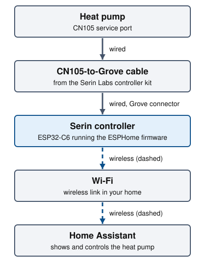

# esphome-devices

[ESPHome](docs/getting-started.md#esphome) configurations for devices that
report to [Home Assistant](docs/getting-started.md#home-assistant). Everything
needed to connect a Mitsubishi heat pump, or to run an AcuRite 433 MHz sensor
bridge, is in this repository or linked from it.

The heat pump controller: the unit's [CN105](docs/getting-started.md#cn105)
port, a Serin controller and Wi-Fi to Home Assistant.

## Devices

- **Mitsubishi heat pump controller**: Serin controllers ordered, not yet installed. [Heat pump controller](docs/heat-pump.md)
- **AcuRite 433 MHz sensor bridge**: in daily use, running this repository's config. [AcuRite bridge](docs/acurite.md)

## Quick start

1. Read [Getting started](docs/getting-started.md): install the tools, then
   create your `secrets.yaml`.
2. Open the guide for your device: [heat pump](docs/heat-pump.md) or
   [AcuRite](docs/acurite.md). Gather the parts it lists.
3. Flash the board, install it and add it to Home Assistant, in the order the
   guide gives.

## Repository map

- `heatpump-*.yaml`: One ESPHome file per heat pump (living room, kid's room, master bedroom).
- `packages/heatpump.yaml`: Settings shared by every heat pump file.
- `acurite-bridge.yaml`: The AcuRite bridge.
- `secrets.example.yaml`: Template for the git-ignored `secrets.yaml`.
- `docs/`: The guides and their images.
- `requirements.txt`: Pins the ESPHome version.

## Credits

These are external projects; this repository configures them.

- Heat pump firmware: [echavet/MitsubishiCN105ESPHome](https://github.com/echavet/MitsubishiCN105ESPHome)
  (BSD 2-Clause).
- AcuRite decoder: [swoboda1337/acurite-esphome](https://github.com/swoboda1337/acurite-esphome)
  (no license file, so its terms are unstated).
- Heat pump controller: [Serin Labs](https://serin-labs.com/controller.html)
  and its [serin-labs/serin-cn105](https://github.com/serin-labs/serin-cn105)
  board settings (MIT).
- AcuRite board: [LILYGO](https://github.com/Xinyuan-LilyGO/LilyGo-LoRa-Series) T3 V1.6.1.

## License

MIT. See [LICENSE](LICENSE). The licenses of the external projects above
apply to them, not to this repository.
