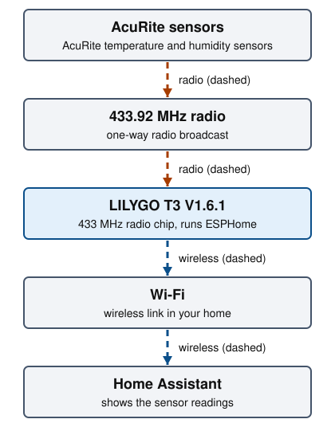

# AcuRite bridge

Receive the radio signals of AcuRite 433 MHz sensors, such as fridge, freezer
and temperature and humidity sensors, and show them in
[Home Assistant](getting-started.md#home-assistant).



The sensors broadcast on 433.92 MHz (the radio frequency AcuRite sensors use).
The LILYGO board receives the broadcasts and sends the readings to Home
Assistant over Wi-Fi.

## Status and audience

Status: in daily use. The author's live bridge runs an earlier copy of this
configuration. The file in this repository, [`acurite-bridge.yaml`](../acurite-bridge.yaml),
compiles but has not yet been flashed to the live unit. Entity names are
kept identical so the switch should not change Home Assistant entities
(not yet confirmed on the live unit).

This guide is for someone who owns AcuRite 433 MHz sensors and a Home
Assistant installation. It needs no soldering. Read
[Getting started](getting-started.md) first.

## What it does

The board listens on 433.92 MHz and decodes AcuRite OOK (on-off keying, the
simple radio modulation these sensors use) messages. For every sensor listed
in the config it creates Home Assistant entities for temperature, humidity
(where the sensor measures it) and battery level. The decoder is the
[swoboda1337/acurite-esphome](https://github.com/swoboda1337/acurite-esphome)
component. Its README lists the supported devices: temperature and humidity
sensor, rain gauge, Notos weather station, Iris weather station, Atlas
weather station, lightning detector, and fridge and freezer temperature
sensor.

## Parts

- **LILYGO T3 V1.6.1 board, 433 MHz variant**: quantity 1. ESP32 plus a radio chip. See the [LILYGO docs](https://github.com/Xinyuan-LilyGO/LilyGo-LoRa-Series/blob/master/docs/en/t3_v161_sx1276/t3_v161_sx1276_hw.md).
- **433 MHz antenna**: quantity 1. Connect it before the board runs.
- **Micro-USB data cable**: quantity 1. For the first flash.
- **AcuRite 433 MHz sensors**: quantity 1 or more. Already installed.

- Buy the 433 MHz variant. The LILYGO page for this board documents the
  SX1276 module with a 830 to 945 MHz range, which does not cover 433.92 MHz.
  Its setup notes also name an SX1278 build option. Which LILYGO listing is
  the 433 MHz one is unverified here: check that the listing you buy says
  433 MHz.
- The LILYGO page warns to connect the antenna before the board transmits,
  or the radio module is easily damaged. This config only receives, but fit
  the antenna anyway.
- The component's README says the small antennas that ship with these boards
  work but are not ideal: their gain is poor, and they sit close to the Wi-Fi
  antenna, which can cause glitches. It names the Siretta Tango 9 as a better
  antenna.

## Find your sensor IDs

Every AcuRite sensor sends an ID. The config needs one for each sensor you
want. Per the component's README, it can run with no sensors configured and
still logs the data of every sensor it hears, so you can read the IDs from
the log first. The IDs are the four hex digits after `id` in the decoder's
log lines (format taken from the source at the pinned commit), for example
`Temperature: ch A, id 0e14, bat 1, temp 4.0, rh 50.0`. That line is an
illustration of the format, not a real reading.

1. Flash the board as described below. The config sets the log level to
   DEBUG, which the decoder's lines need.
2. Run this in a laptop terminal, from the repository root:

   ```sh
   .venv/bin/esphome logs acurite-bridge.yaml
   ```

3. Wait for your sensors to transmit.
4. Note the `id` of each line that belongs to a sensor of yours. The first
   word of the line names the type: `Fridge`, `Freezer`, `Temperature`,
   `Rainfall`, `Lightning`, `Notos 3in1`, `Iris 5in1`.
5. To match an ID to a temperature sensor, warm that sensor in your hand and
   watch which ID's temperature rises.

## Edit the sensor list

Open [`acurite-bridge.yaml`](../acurite-bridge.yaml). The `binary_sensor`
block creates battery entities and the `sensor` block creates temperature and
humidity entities. Each entry starts with `device:`, the ID as `0x` followed
by the four hex digits.

The current file lists three sensors:

- `0x0e14`: temperature, humidity, battery, named Mini Freezer in Home Assistant.
- `0x0376`: temperature, battery, named Refrigerator in Home Assistant.
- `0x01ef`: temperature, battery, named Freezer in Home Assistant.

Replace these IDs and names with yours. For each sensor, change the `device`
value in both blocks, and rename the entities. The `device_id` lines place
entities in the "Kitchen Device" group; change the `areas` and `devices`
block near the top if your sensors live elsewhere. The component's README
shows entries for rain, wind, lightning and other sensor types.

The radio pins in the config (`spi_clk_pin`, `sx127x_cs_pin` and the others
under `substitutions`) match the LILYGO T3 V1.6.1 pin map for SCK, MISO,
MOSI, CS and RESET. The LILYGO page's pin table does not list the radio's
DIO0 line (GPIO26 here), so that one is unverified against LILYGO's docs. It
matches the component README's example. `remote_receiver_pin` (GPIO32) is
the radio's DIO2 line in LILYGO's table. The config selects the ESPHome board
definition `ttgo-lora32-v21` and sets every radio pin explicitly.

Check the file after editing. Run this in a laptop terminal:

```sh
.venv/bin/esphome config acurite-bridge.yaml
```

## Secrets

The AcuRite bridge reads three keys from `secrets.yaml`, plus the shared Wi-Fi
keys. [Getting started](getting-started.md#fill-in-the-secrets) shows how to
generate them.

- `acurite_api_encryption_key`: Encrypts the link to Home Assistant.
- `acurite_ota_password`: Protects Wi-Fi firmware updates.
- `acurite_ap_password`: Protects the fallback Wi-Fi network.

## Flash and add to Home Assistant

1. Attach the antenna, then connect micro-USB.
2. Run this in a laptop terminal, from the repository root:

   ```sh
   .venv/bin/esphome run acurite-bridge.yaml
   ```

3. Choose the serial port when asked.
4. Add the device `acurite-bridge` in Home Assistant as described in
   [Getting started](getting-started.md#add-a-device-to-home-assistant).
   The key is `acurite_api_encryption_key`.
5. Later updates run with `--device OTA`.

## Check it worked

The device appears in Home Assistant under the area "Kitchen". Each sensor in
the list shows a temperature entity, and the mini freezer sensor also shows
humidity. A sensor's entity updates only when that sensor transmits.

Battery entities come from the `binary_sensor` block, for example
"Refrigerator Sensor Battery Level". The component's README documents
`battery_level` as a binary sensor. Which state means low is not stated there,
so it is unverified here: compare against a sensor whose battery you know.

## Troubleshooting

### Device not in Home Assistant

**Likely cause:** Wrong Wi-Fi settings, or discovery blocked.

**Fix:** Read the log over USB. Fix `secrets.yaml`. Or add it with `acurite-bridge.local`.

### Wi-Fi fallback access point `acurite-bridge` appears

**Likely cause:** The board cannot join your Wi-Fi.

**Fix:** Join it with `acurite_ap_password`, or fix `secrets.yaml` and flash over USB.

### No sensor lines in the log

**Likely cause:** No antenna, a sensor out of range, a sensor on another frequency, or the wrong board variant.

**Fix:** Fit the antenna. Move a sensor close to the board. Check the board is the 433 MHz variant.

### Entities stay unavailable

**Likely cause:** The IDs in the file do not match your sensors.

**Fix:** Read the IDs from the log and edit the lists.

### Readings drop out when Wi-Fi is busy

**Likely cause:** A weak antenna next to the Wi-Fi antenna.

**Fix:** Use a better 433 MHz antenna, as the component's README suggests.

For `pip` errors on Python 3.15, see [Set up the project](getting-started.md#set-up-the-project).

## Credits

- Decoder: [swoboda1337/acurite-esphome](https://github.com/swoboda1337/acurite-esphome).
  It has no license file (GitHub reports none), so its terms are unstated.
  This repository does not copy it; the config downloads it at build time.
  Open an issue upstream if you need explicit terms.
- Radio driver: ESPHome's `sx127x` component. The decoder README also links
  its author's repository,
  [swoboda1337/sx127x-esphome](https://github.com/swoboda1337/sx127x-esphome).
- Board: [LILYGO LoRa series](https://github.com/Xinyuan-LilyGO/LilyGo-LoRa-Series).
- ESP32: [Espressif](https://www.espressif.com/).

These are external projects.

## Next step

- [Heat pump bridge](heat-pump.md)
- [Back to the repository README](../README.md)
