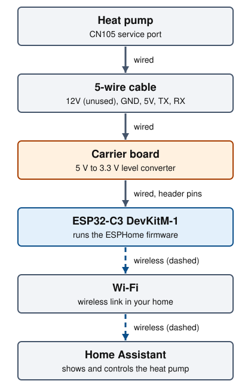
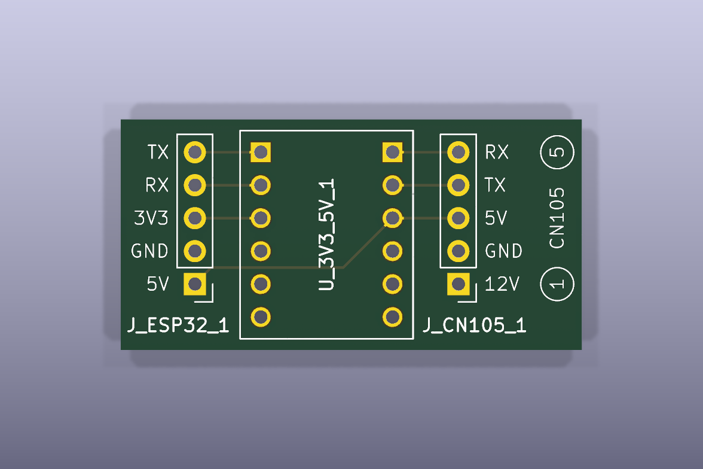
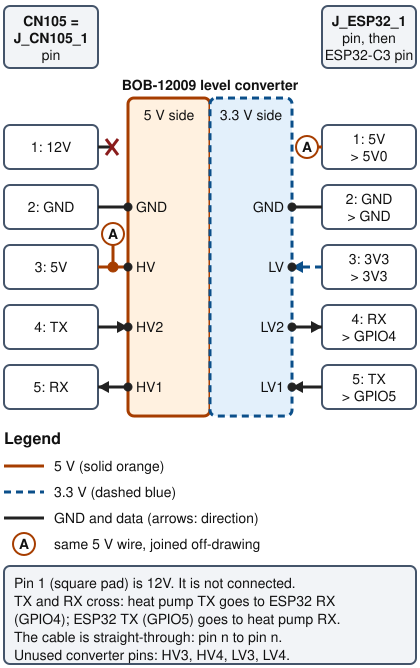
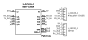
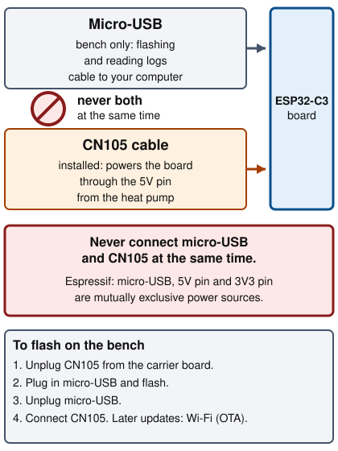
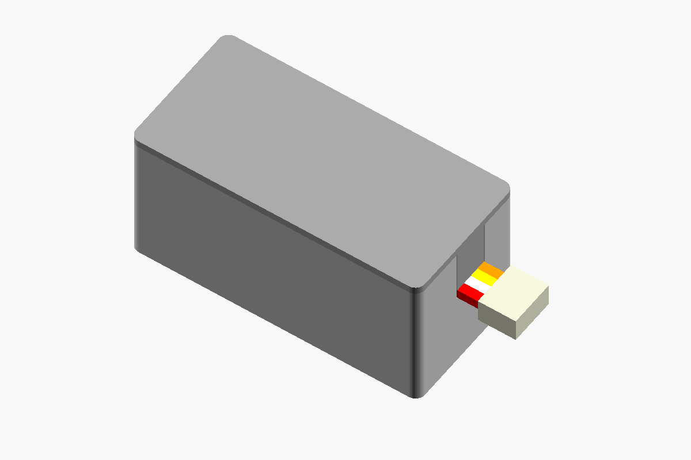
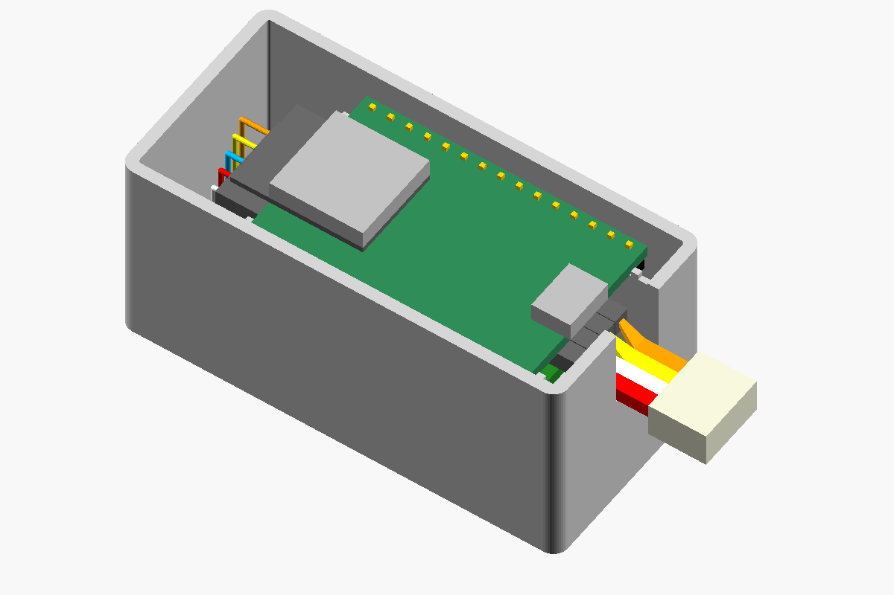
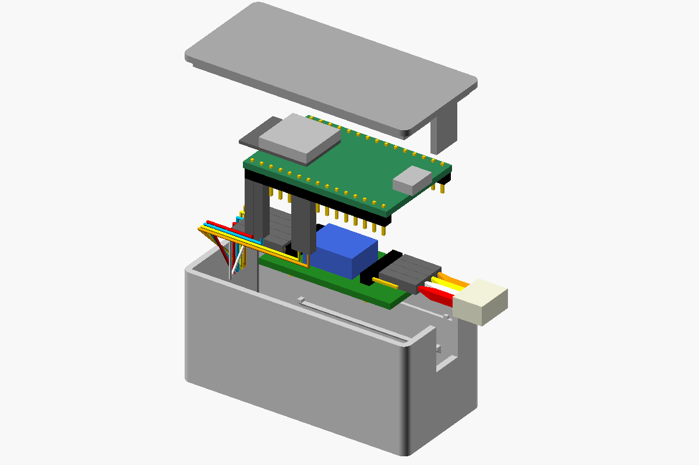

# Heat pump bridge

Connect a Mitsubishi indoor heat pump unit to [Home Assistant](getting-started.md#home-assistant)
with an ESP32 board that plugs into the unit's [CN105](getting-started.md#cn105)
port.



The heat pump talks to the ESP32 over the cable, and the ESP32 talks to Home
Assistant over Wi-Fi.

## Status and audience

Status: assembled, bench test pending. The author has built the hardware but
has not yet bench tested it or run it on a heat pump. The enclosure is
designed but has never been printed, and the space for it inside the heat
pump unit is unmeasured. Nothing in this guide is a field report. The
firmware component is third-party and its authors tested it; see
[Supported units](#supported-units).

This guide is for someone who can follow a wiring list and use a multimeter.
You do not need to have used ESPHome or KiCad before. Read
[Getting started](getting-started.md) first.

## Supported units

The firmware is
[echavet/MitsubishiCN105ESPHome](https://github.com/echavet/MitsubishiCN105ESPHome)
(BSD 2-Clause license). Its README says indoor units with a CN105 header are
generally compatible and links a list of supported models. Its README also
carries a "use at your own risk" notice: the protocol is reverse engineered
and not every unit supports every feature.

Where CN105 sits on the indoor unit's circuit board varies by model. Check
your unit's service documentation or the model list the README links. This
repository has not verified any specific model.

The echavet README lists tested microcontrollers. The ESP32-C3 board used
here is not on that list, so it is untested by the firmware authors as well.

## Safety

The indoor unit runs on mains voltage.

1. Turn the indoor unit off at its circuit breaker before you open the
   panel.
2. Leave it off while you plug or unplug the cable.
3. Close the panel before you restore power.

If you are not comfortable working inside the unit, ask a qualified
technician. Connecting third-party hardware may affect your warranty
(unverified; check your terms).

## Parts

- **[SparkFun ESP32-C3 Mini Development Board, WRL-18036](https://www.sparkfun.com/products/18036)**: quantity 1. SparkFun's product page links Espressif's ESP32-C3-DevKitM-1 V1 documentation for this board, including the [Espressif DevKitM-1 user guide](https://docs.espressif.com/projects/esp-dev-kits/en/latest/esp32c3/esp32-c3-devkitm-1/user_guide.html) and schematic. Espressif's published schematic wires a CP2102N USB-to-serial chip to GPIO20 and GPIO21 (UART0), which is why the log appears over micro-USB. Verified against the published schematic, not against the physical board.
- **Carrier board**: quantity 1. Order from a PCB fab; see below.
- **[SparkFun Logic Level Converter, BOB-12009](https://www.sparkfun.com/products/12009)**: quantity 1. Converts 4 channels between 5 V and 3.3 V.
- **Right-angle male pin header, 1x5, 2.54 mm pitch**: quantity 2. One on each side of the carrier board.
- **JST PAP-05V-S housing with crimp terminals, or a pre-made 5-wire pigtail**: quantity 1. Plugs into CN105.
- **Dupont jumper wires, female to female**: quantity 5. Carrier board to ESP32.
- **Printed box and lid**: quantity 1 of each. Holds both boards; see
  [Fit the enclosure](#fit-the-enclosure).

Quantities are per bridge. The Dupont pitch is 2.54 mm. The CN105 housing is
2.0 mm pitch, so Dupont plastic bodies do not fit the unit end.
[SwiCago/HeatPump](https://github.com/SwiCago/HeatPump) lists the
PAP-05V-S housing, matching crimp terminals and pre-made pigtails.

For the carrier board, download
[`heatpump-bridge-gerbers.zip`](../hardware/heatpump-bridge/fabrication/heatpump-bridge-gerbers.zip)
and upload it to a PCB fabrication service. Ask for:

- 2 layers (copper on top and bottom).
- 1.6 mm thickness (the standard board thickness).
- Board outline from the zip: the file ending `Edge_Cuts.gm1`. The board is
  35.56 x 17.78 mm.

The [board README](../hardware/heatpump-bridge/README.md) lists the zip
contents and the design files.

## Assemble



Top of the carrier board. Pin 1 of each header is the square pad at the
bottom.

1. Solder one right-angle 1x5 male header into each of J_ESP32_1 (left in
   the picture) and J_CN105_1 (right), on the converter side of the board
   with the pins pointing off the board ends.
2. Solder the BOB-12009 converter into the 12-hole footprint labelled
   U_3V3_5V_1. Its HV pins face J_CN105_1 and its LV pins face J_ESP32_1.
   Compare the converter's own pin markings with the HV1 to HV4 and LV1 to
   LV4 labels printed on the bottom of the carrier board.
3. Build the CN105 cable: crimp five wires into the PAP-05V-S housing and
   fit a female Dupont end on each wire, or use a pre-made pigtail with
   Dupont ends.
4. Build the ESP32 cable from five Dupont jumpers. Both ends end up inside
   the box, so they only need to reach from the carrier board to the ESP32.
   The author re-housed the jumper ends so they plug in as one block; this
   is optional.

### Wiring list

Pin numbers run 1 to 5. Pin 1 is the square pad. Both headers number the
same way, bottom to top in the picture above. The
[wiring diagram](images/heatpump-wiring.svg) is the readable version of the
schematic.



Wiring from the heat pump to the ESP32. TX and RX cross.

J_CN105_1, the heat pump side. Wire it to the CN105 cable in this order:

1. 12V: not connected on the carrier board. Leave this wire unused.
2. GND: ground.
3. 5V: powers the ESP32 and the 5 V side of the converter.
4. TX: the heat pump's transmit line. It ends at ESP32 GPIO4.
5. RX: the heat pump's receive line. It ends at ESP32 GPIO5.

J_ESP32_1, the ESP32 side. Wire it to the ESP32 board with the jumpers in
this order:

1. 5V: to the ESP32 `5V` pin. This is the bridge's only power input.
2. GND: to an ESP32 `GND` pin.
3. 3V3: to the ESP32 `3V3` pin. The ESP32 supplies 3.3 V to the converter
   here.
4. RX: to ESP32 `IO4` (GPIO4), the ESP32's receive pin.
5. TX: to ESP32 `IO5` (GPIO5), the ESP32's transmit pin.

Pin names on the ESP32 board follow the Espressif user guide's header
tables. The author's pigtail uses red for GND, white for 5V, yellow for TX
and orange for RX on pins 2 to 5. Wire colors vary by supplier, so confirm
each wire with the meter checks below instead of by color.

Why GPIO4 and GPIO5: GPIO20 and GPIO21 (UART0) are deliberately not used.
UART0 is wired to the board's USB-to-serial chip and carries the boot log,
the serial bootloader and, in this configuration, the logger, so a heat pump
on those pins would collide with flashing and logs. GPIO4 and GPIO5 are not
[strapping pins](getting-started.md#strapping-pin) either.

<details>
<summary>Full schematic (KiCad export)</summary>



[Open the schematic SVG](images/heatpump-schematic.svg) to zoom in. The
wiring diagram above is the readable version.

</details>

### Check the orientation with a meter

Do this before the first power-up. The indoor unit stays off, and nothing is
connected to the ESP32. A wire on the wrong pin can put 12 V on a 5 V input
and damage the converter or the ESP32.

1. Set a multimeter to continuity (the setting that beeps).
2. Plug the CN105 cable into J_CN105_1 with the wire for CN105 pin 1 on the
   square pad marked "1". The board also prints circled 1 and 5 beside the
   header.
3. Touch one probe to the metal terminal visible inside each housing cavity
   and the other to the same-numbered header pin. All five wires must land
   on the same-numbered header pin, so a one-pin shift fails the check. Each
   of the five pairs must beep, and no other combination may.
4. Confirm that J_CN105_1 pin 2 (GND) and pin 3 (5V) do not beep against
   each other.
5. Confirm that the wire for CN105 pin 1 beeps against header pin 1 and
   against no other header pin. Header pin 1 is the 12V pin and nothing else
   on the board uses it.

Identify pin 1 on the unit's CN105 header from the demo circuit in the
[SwiCago/HeatPump README](https://github.com/SwiCago/HeatPump#demo-circuit)
and your unit's service documentation. Whether the PAP-05V-S housing can be
plugged in reversed is unverified, so confirm that the wire for pin 1 lands
on pin 1. The five-pin Dupont header on the carrier board has no
keying, so it can also be plugged in reversed or shifted by one pin. The
V2 board ideas in
[issue 2](https://github.com/kjiwa/esphome-devices/issues/2) include a keyed
connector.

## The power rule



Never connect both at once.

The bridge draws its power from CN105 through the ESP32 `5V` pin. Espressif's
user guide states that micro-USB, the `5V` pin and the `3V3` pin are three
mutually exclusive ways to power the board. So:

- Flash over USB with CN105 unplugged from the carrier board.
- Unplug micro-USB before you connect CN105.
- The closed box has no micro-USB opening. To flash over USB again, open the
  lid and unplug CN105 first.
- Update later over Wi-Fi ([OTA](getting-started.md#ota)).

## Flash the firmware

1. Complete [Getting started](getting-started.md), including the secrets
   file.
2. Pick the device file for your room: `heatpump-livingroom.yaml`,
   `heatpump-kidsroom.yaml` or `heatpump-masterbedroom.yaml`. To add a room,
   copy one file and change its `name` and `area` lines. Every file includes
   [`packages/heatpump.yaml`](../packages/heatpump.yaml), which holds the
   settings that all rooms share.
3. Connect micro-USB to the ESP32 board, outside the box. CN105 stays
   unplugged.
4. Run this in a laptop terminal, from the repository root:

   ```sh
   .venv/bin/esphome run heatpump-livingroom.yaml
   ```

5. Choose the serial port when asked. The log shows the device joining Wi-Fi.
6. Add the device in Home Assistant as described in
   [Getting started](getting-started.md#add-a-device-to-home-assistant). Use
   the value of `heatpump_api_encryption_key` as the key.
7. Unplug micro-USB.

The log appears over micro-USB because the config sets the logger to
UART0. The serial speed to the heat pump is 2400 baud: the
[baud rate](getting-started.md#baud-rate) the CN105 port uses.

## Fit the enclosure

Status: designed, never printed. The space inside the heat pump unit is
unmeasured, so check that the box fits before you print it.



The closed box. A render of the OpenSCAD model, not a photo. The wires and
connector housing are simplified and the routing is illustrative.



The box with the lid off. A render, not a photo. The ESP32 is a simplified
block shape and the wire routing is illustrative.



The parts pulled apart. A render, not a photo.

The box holds the carrier board, the ESP32 and the five jumpers. Only the
CN105 lead leaves it, through the notch.

### Print the box and lid

1. Generate the two STL files by following the
   [board README](../hardware/heatpump-bridge/README.md#enclosure). An STL
   file is the 3D model format a slicer reads. A slicer is the program that
   turns the model into instructions for a 3D printer. The same README shows
   how to render the model to read the box's outer size.
2. Print in PETG or ASA. How either behaves near the unit's coil is
   unverified.
3. Print the box floor down and the lid plate down.

### Assemble the enclosure

1. Flash the ESP32 before it goes in the box, as in
   [Flash the firmware](#flash-the-firmware), with CN105 unplugged.
2. Plug the five jumpers into J_ESP32_1 and onto the ESP32 pins, as in the
   [wiring list](#wiring-list). Plug the CN105 lead into J_CN105_1.
3. Set the carrier board in the box, converter side up.
4. Rest the ESP32 above it, parts up.
5. Lay the CN105 lead in the notch, with its housing outside the box.
6. Press the lid on. Its tab clamps the lead in the notch.

## Install and check it worked

1. Turn the indoor unit off at the breaker.
2. Open the panel. Plug the lead from the closed box into the unit's CN105
   header.
3. Close the panel, then restore power.
4. Wait for the device to come online in Home Assistant.

A working bridge shows these:

- A climate entity named after the device, for example "Heat Pump (Living
  Room)". The firmware authors say you should be able to change modes and
  temperature setpoints from it.
- An Uptime sensor on the same device.
- With the log open (run this in a laptop terminal), lines like
  `Cycle ended in 1.2 seconds (with timeout?: NO)`:

  ```sh
  .venv/bin/esphome logs heatpump-livingroom.yaml
  ```

If `with timeout?: YES` appears, see [Troubleshooting](#troubleshooting).

## Tune the update interval

`update_interval: 2s` in [`packages/heatpump.yaml`](../packages/heatpump.yaml)
sets how often the firmware polls the heat pump: 2 seconds. The firmware
authors say it should not go below the cycle time the log reports. They give
a worked example: a 1.2 second cycle suits about 1.5 seconds. The comment in
the file recommends values between 1 and 4 seconds.

Edit the value, then flash again over Wi-Fi with this command in a laptop
terminal:

```sh
.venv/bin/esphome run heatpump-livingroom.yaml --device OTA
```

## Troubleshooting

The heat pump bridge has not been bench tested. These entries come from the
firmware's documentation and from reading the configuration, so treat them
as expected behavior, not field reports.

### Device not in Home Assistant

**Likely cause:** The ESP32 did not join Wi-Fi: wrong SSID or password in `secrets.yaml`, or a 5 GHz-only network. Or discovery is blocked.

**Fix:** Flash over USB and read the log. Correct `secrets.yaml`. Or add the device by hand with its `.local` name or IP address.

### Device in Home Assistant but no climate entity

**Likely cause:** The firmware on the board is not the heat pump config, or the entity is hidden.

**Fix:** Open the device page in Home Assistant. If only Uptime shows, flash a `heatpump-*.yaml` file again.

### Log shows `with timeout?: YES`

**Likely cause:** No answer from the heat pump: TX and RX swapped, no 5 V on CN105 pin 3, a loose or shifted connector, or a unit without CN105 support. A cold-boot UART issue is also described in the firmware README.

**Fix:** Repeat the meter checks. Confirm pins 4 and 5. Read the WARNING at the top of the [firmware README](https://github.com/echavet/MitsubishiCN105ESPHome).

### TX and RX wired swapped

**Likely cause:** J_ESP32_1 pin 4 (RX) must reach GPIO4 and pin 5 (TX) must reach GPIO5. A swap stops all communication. The log shows timeouts.

**Fix:** Swap the two jumpers at the ESP32 end. From the schematic the swap should not cause damage (reasoned, not tested).

### Wi-Fi fallback access point appears

**Likely cause:** The ESP32 cannot join your Wi-Fi, so it starts its own network named after the device, for example `heatpump-livingroom`.

**Fix:** Connect with the value of `heatpump_ap_password` and set up Wi-Fi again, or correct `secrets.yaml` and flash over USB.

For `pip` errors on Python 3.15, see [Set up the project](getting-started.md#set-up-the-project).

## Credits

- Firmware: [echavet/MitsubishiCN105ESPHome](https://github.com/echavet/MitsubishiCN105ESPHome),
  BSD 2-Clause, built on the
  [SwiCago/HeatPump](https://github.com/SwiCago/HeatPump) library.
- ESP32 board: Espressif's ESP32-C3-DevKitM-1, sold by SparkFun as WRL-18036.
- Converter: SparkFun BOB-12009.

These are external projects. This repository only configures and wires them.

## Next step

- [Board README](../hardware/heatpump-bridge/README.md): files, fabrication
  and rebuild.
- [Enclosure design notes](../hardware/heatpump-bridge/README.md#enclosure):
  layout, parameters and the build commands.
- [AcuRite bridge](acurite.md)
