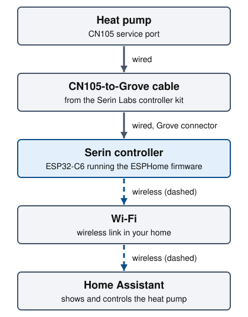
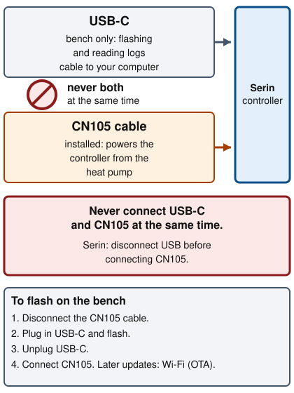

# Heat pump controller

Connect a Mitsubishi indoor heat pump unit to [Home Assistant](getting-started.md#home-assistant)
with a prebuilt Serin Labs ESP32 controller that plugs into the unit's
[CN105](getting-started.md#cn105) port.



The heat pump talks to the controller over the cable, and the controller talks
to Home Assistant over Wi-Fi.

## Status and audience

Status: ordered, not yet installed. Nothing in this guide is a field report.
The firmware component is third-party and its authors tested it; see
[Supported units](#supported-units). The room thermometer feed compiles but has
not run on a heat pump.

This guide is for someone comfortable opening an indoor unit's cover. You do
not need to have used ESPHome before. Read [Getting started](getting-started.md)
first.

## Supported units

The firmware is
[echavet/MitsubishiCN105ESPHome](https://github.com/echavet/MitsubishiCN105ESPHome)
(BSD 2-Clause license). Its README says indoor units with a CN105 header are
generally compatible and links a list of supported models. Its README also
carries a "use at your own risk" notice: the protocol is reverse engineered
and not every unit supports every feature.

Where CN105 sits on the indoor unit's circuit board varies by model. Check
your unit's service documentation or the model list the README links. This
repository has not verified any specific model.

## Safety

The indoor unit runs on mains voltage.

1. Turn the indoor unit off at its circuit breaker before you open the
   panel.
2. Leave it off while you plug or unplug the cable.
3. Close the panel before you restore power.

If you are not comfortable working inside the unit, ask a qualified
technician. Connecting third-party hardware may affect your warranty
(unverified; check your terms).

## Parts

- **[Serin Labs CN105 ESP32 Controller](https://serin-labs.com/controller.html)**: quantity 1 per unit. It ships with a CN105-to-Grove cable, in 20 cm or 50 cm. Serin recommends 20 cm for wall units and cassettes, where the board tucks inside, and 50 cm for metal-bodied ducted air handlers. It ships unflashed, with an ESP32-S3 board that this repository's config targets. Serin also sells an ESP32-C6 version; change the `board`, `flash_size` and pin substitutions in `packages/heatpump.yaml` to the values in Serin's [ESP32-C6 board file](https://github.com/serin-labs/serin-cn105/blob/main/esphome/common/esp32c6.yaml).
- **A USB-C data cable**: for flashing. Power-only cables do not work.

The cable has no level shifting. The CN105 data lines run at 5 V and the
ESP32 pins at 3.3 V, which is outside the chip's rating, and the firmware
README advises a level shifter. Users report direct connections working: five
boards for about two years ([echavet discussion
348](https://github.com/echavet/MitsubishiCN105ESPHome/discussions/348)) and
two boards for over a year ([dpmworld issue 3](https://github.com/dpmworld/Mitsubishi-MSZ-HJ25VA-Home-Assistant-Integration/issues/3)).
No failures are reported there, but these are anecdotes, and Serin's pages
do not mention protection (unverified). A failure would likely stop the
controller talking to the unit.

## Flash the firmware

Flash with this repository's device file, not Serin's web flasher, so your
secrets and the room temperature feed apply.

1. Complete [Getting started](getting-started.md), including the secrets
   file.
2. Pick the device file for your room: `heatpump-livingroom.yaml`,
   `heatpump-kidsroom.yaml` or `heatpump-masterbedroom.yaml`. To add a room,
   copy one file and change its `name` and `area` lines. Every file includes
   [`packages/heatpump.yaml`](../packages/heatpump.yaml), which holds the
   settings that all rooms share.
3. Connect USB-C to the controller. The CN105 cable stays disconnected.
4. Run this in a laptop terminal, from the repository root:

   ```sh
   .venv/bin/esphome run heatpump-livingroom.yaml
   ```

5. Choose the serial port when asked. The log shows the device joining Wi-Fi.
6. Add the device in Home Assistant as described in
   [Getting started](getting-started.md#add-a-device-to-home-assistant). Use
   the value of `heatpump_api_encryption_key` as the key.
7. Unplug USB-C.

The serial speed to the heat pump is 2400 baud: the
[baud rate](getting-started.md#baud-rate) the CN105 port uses.

If the board does not show up as a serial port, try another USB-C data cable
before anything else.

## The power rule



Never connect both at once.

Serin's [setup guide](https://serin-labs.com/esphome/setup.html) says to
disconnect USB before connecting CN105. So:

- Flash over USB-C with the CN105 cable disconnected.
- Unplug USB-C before you connect the CN105 cable.
- To flash over USB again, disconnect the CN105 cable first.
- Update later over Wi-Fi ([OTA](getting-started.md#ota)).

## Install

1. Turn the indoor unit off at the breaker.
2. Take off the front cover and find CN105 on the control board.
3. Plug the cable into CN105 and the other end into the controller.
4. Place the controller in the right-hand cavity of the unit. No drilling is
   expected (unverified until the first install).
5. Close the cover, then restore power.
6. Wait for the device to come online in Home Assistant.

## Check it worked

A working controller shows these:

- A climate entity named after the device, for example "Heat Pump (Living
  Room)". The firmware authors say you should be able to change modes and
  temperature setpoints from it.
- An Uptime sensor and a Wi-Fi signal sensor on the same device. Read the
  signal with the cover on and with it off. If the signal drops out with the
  cover on, reposition the controller inside the cavity.
- With the log open (run this in a laptop terminal), lines like
  `Cycle ended in 1.2 seconds (with timeout?: NO)`:

  ```sh
  .venv/bin/esphome logs heatpump-livingroom.yaml
  ```

If `with timeout?: YES` appears, see [Troubleshooting](#troubleshooting).

## Tune the update interval

`update_interval: 2s` in [`packages/heatpump.yaml`](../packages/heatpump.yaml)
sets how often the firmware polls the heat pump: 2 seconds. The firmware
authors say it should not go below the cycle time the log reports. They give
a worked example: a 1.2 second cycle suits about 1.5 seconds. The comment in
the file recommends values between 1 and 4 seconds.

Edit the value, then flash again over Wi-Fi with this command in a laptop
terminal:

```sh
.venv/bin/esphome run heatpump-livingroom.yaml --device OTA
```

## Use a room thermometer

The heat pump regulates to its own sensor, which sits in the indoor unit and
can read warmer or cooler than the room. The firmware can take a temperature
from Home Assistant instead, so the number on the remote means the temperature
a room thermometer reads. Home Assistant only supplies a reading. Mode,
setpoint, fan and power stay with the remote.

1. In Home Assistant, create a template sensor helper per room (Settings,
   Devices & services, Helpers) named after the entity in the room's device
   file, for example `sensor.heatpump_livingroom_room_temperature`. Set its
   unit to °F and its device class to temperature. Use this state template,
   with your thermometer's entity and the longest gap you accept in hours:

   ```jinja
   
   {{ s.state if s and now() - s.last_reported < timedelta(hours=3) else none }}
   ```

2. Flash the device again over Wi-Fi, as in
   [Tune the update interval](#tune-the-update-interval).

The helper reports a non-numeric state when the thermometer is unavailable or
stops reporting, and the device sends nothing for such a state or for a
reading outside 1 to 40 °C. The unit returns to its own sensor, so the remote
keeps working, in these cases:

- The thermometer is offline or its reading is out of range: the helper is
  non-numeric, the device stops sending and the firmware times out after 10
  minutes.
- Home Assistant or Wi-Fi is down: the device stops sending, with the same
  timeout.
- The ESP32 is down: the unit receives no updates and reverts by itself
  (a firmware source comment says so; unverified on hardware).

Home Assistant is assumed to use °F. For °C, change `(x - 32) * (5.0 / 9.0)`
to `x` in [`packages/heatpump.yaml`](../packages/heatpump.yaml).

## Troubleshooting

The controller has not been installed yet. These entries come from the
firmware's documentation and from reading the configuration, so treat them
as expected behavior, not field reports.

### Device not in Home Assistant

**Likely cause:** The controller did not join Wi-Fi: wrong SSID or password in `secrets.yaml`, or a 5 GHz-only network. Or discovery is blocked.

**Fix:** Flash over USB and read the log. Correct `secrets.yaml`. Or add the device by hand with its `.local` name or IP address.

### Device in Home Assistant but no climate entity

**Likely cause:** The firmware on the board is not the heat pump config, or the entity is hidden.

**Fix:** Open the device page in Home Assistant. If only Uptime shows, flash a `heatpump-*.yaml` file again.

### Log shows `with timeout?: YES`

**Likely cause:** No answer from the heat pump: a loose cable, or a unit without CN105 support. A cold-boot UART issue is also described in the firmware README.

**Fix:** Reseat the cable at both ends with the unit off at the breaker. Read the WARNING at the top of the [firmware README](https://github.com/echavet/MitsubishiCN105ESPHome).

### Weak or dropping Wi-Fi

**Likely cause:** The unit's metal casing shields the controller. One MSZ-GL18NA owner reported dropouts with the board inside the unit.

**Fix:** Read the Wi-Fi signal sensor with the cover on and off, then reposition the controller inside the cavity.

### Wi-Fi fallback access point appears

**Likely cause:** The controller cannot join your Wi-Fi, so it starts its own network named after the device, for example `heatpump-livingroom`.

**Fix:** Connect with the value of `heatpump_ap_password` and set up Wi-Fi again, or correct `secrets.yaml` and flash over USB.

For `pip` errors on Python 3.15, see [Set up the project](getting-started.md#set-up-the-project).

## Credits

- Firmware: [echavet/MitsubishiCN105ESPHome](https://github.com/echavet/MitsubishiCN105ESPHome),
  BSD 2-Clause, built on the
  [SwiCago/HeatPump](https://github.com/SwiCago/HeatPump) library.
- Controller hardware and board settings: [Serin Labs](https://serin-labs.com/controller.html)
  and [serin-labs/serin-cn105](https://github.com/serin-labs/serin-cn105)
  (MIT).

These are external projects. This repository only configures them.

## Next step

- [AcuRite bridge](acurite.md)
