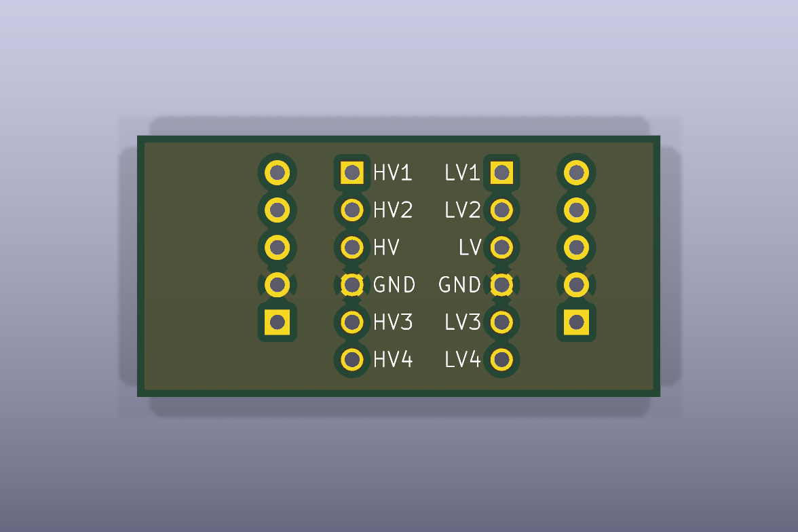

# Heat pump bridge carrier board

A small circuit board that joins a Mitsubishi heat pump's
[CN105](../../docs/getting-started.md#cn105) port to an ESP32 board. It holds a
5 V to 3.3 V
[logic-level converter](../../docs/getting-started.md#logic-level-converter)
and two five-pin headers. The
[heat pump guide](../../docs/heat-pump.md) explains how to build and use it.


Top of the board as rendered by KiCad.



Bottom of the board as rendered by KiCad.

## Board facts

- Size: 35.56 x 17.78 mm (1.4 x 0.7 in): the board outline.
- Thickness: 1.6 mm: the board thickness the design assumes.
- Copper layers: 2 (top and bottom).
- Pin pitch: 2.54 mm (0.1 in) for both headers and the converter pads.
- Converter module: 13.33 x 16.05 mm: the outline drawn in the footprint.
- Revision: 1, with title block date 2025-09-28.
- License: MIT. Everything under `hardware/` is covered by the repository's
  [LICENSE](../../LICENSE).

## Pinout

Pin 1 of each header is the square pad.

- Pin 1: J_CN105_1 12V, not connected; J_ESP32_1 5V.
- Pin 2: J_CN105_1 GND; J_ESP32_1 GND.
- Pin 3: J_CN105_1 5V; J_ESP32_1 3V3.
- Pin 4: J_CN105_1 TX; J_ESP32_1 RX.
- Pin 5: J_CN105_1 RX; J_ESP32_1 TX.

The [heat pump guide](../../docs/heat-pump.md#wiring-list) explains each
wire and the checks to run before first power-up.

## Bill of materials

- **[SparkFun BOB-12009](https://www.sparkfun.com/products/12009) logic level converter**: quantity 1. 4 channels, 5 V to 3.3 V.
- **Male pin header, 1x5, 2.54 mm**: quantity 2. J_CN105_1 and J_ESP32_1.

The ESP32 board, cables and Dupont jumpers are not part of this board. The
full parts list is in the [heat pump guide](../../docs/heat-pump.md#parts). A
different converter fits only if its pads match the footprint (unverified).

## Fabrication files

[`fabrication/heatpump-bridge-gerbers.zip`](fabrication/heatpump-bridge-gerbers.zip)
holds the files a PCB fabrication service needs. Gerber files are the
industry-standard format for board layers. The zip contains 9 files:

- `F_Cu.gtl`, `B_Cu.gbl`: Top and bottom copper.
- `F_Mask.gts`, `B_Mask.gbs`: Top and bottom solder mask.
- `F_Silkscreen.gto`, `B_Silkscreen.gbo`: Top and bottom printed labels.
- `Edge_Cuts.gm1`: Board outline.
- `PTH.drl`, `NPTH.drl`: Drill holes: plated and not plated.

Ask the fab for 2 layers and 1.6 mm thickness, and take the board outline
from the `Edge_Cuts.gm1` file.

## Open the design in KiCad

[KiCad](https://www.kicad.org/) is free software for drawing circuits and
boards. These files were made with KiCad 10.

1. Install KiCad 10.
2. Choose File, then Open Project, and select `heatpump-bridge.kicad_pro` in
   this folder.
3. The schematic is `heatpump-bridge.kicad_sch` and the board layout is
   `heatpump-bridge.kicad_pcb`.

The `BOB-12009` symbol (`heatpump-bridge.kicad_sym`) and footprint
(`heatpump-bridge.pretty/BOB-12009.kicad_mod`) are project-local and drawn
from the datasheet geometry. The project's `sym-lib-table` and `fp-lib-table`
files point to them.

## Regenerate the generated files

The Makefile in the repository root rebuilds the images and the fabrication
zip from the KiCad files. It needs KiCad 10's `kicad-cli` and `zip`. The
`KICAD_CLI` variable defaults to the macOS install path; override it
elsewhere. Run these in a laptop terminal, from the repository root:

```sh
make fab
make images
make check
```

- `make fab` writes the Gerber and drill files, and zips them to
  `fabrication/heatpump-bridge-gerbers.zip`.
- `make images` rebuilds the two board renders and the schematic SVG in
  `docs/images/`.
- `make check` rebuilds the schematic SVG and Gerbers in a temporary folder
  and compares them with the committed files.

On Linux, for example, pass the command name:

```sh
make fab KICAD_CLI=kicad-cli
```

## Ideas for version 2

[Issue 2](https://github.com/kjiwa/esphome-devices/issues/2) collects V2
board ideas: ESP32 sockets in place of jumpers, a keyed CN105 connector, a
wider 5 V trace, mounting holes and the revision and date on the silkscreen.
